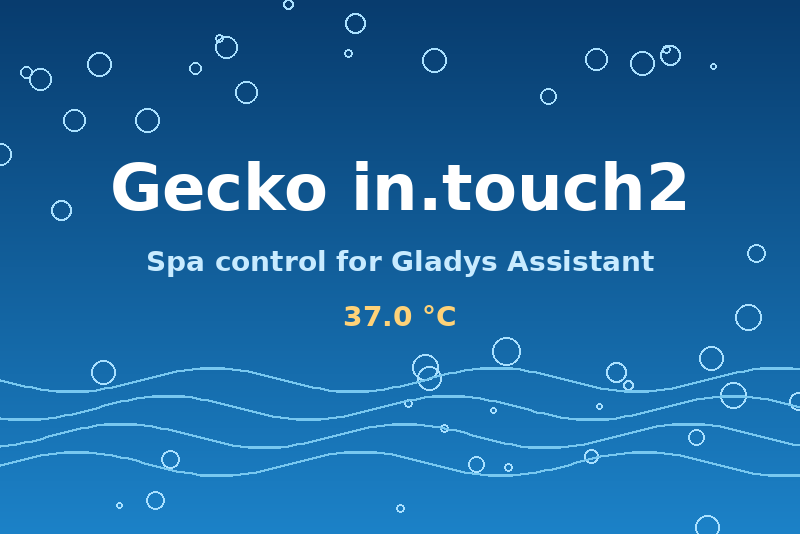

# Gecko in.touch2 for Gladys Assistant



External integration for [Gladys Assistant](https://gladysassistant.com) that
controls spas equipped with a **Gecko** controller and its **in.touch2** Wi-Fi
module — **locally**, over the in.touch2 UDP protocol, without any cloud
account.

- 🌡️ Water temperature, target temperature, heating
- 💦 Pumps (1 to 5), blower, waterfall, lights, circulation pump, ozone
- 🧪 Water care mode (Away, Standard, Energy saving, Super energy saving, Weekender)
- 📡 Radio signal between the in.touch2 module and the spa
- 🎬 Scene triggers and actions, 📊 a dashboard widget
- 🌍 English, French, German and Spanish

User documentation (re-hosted by Gladys, linked from the Configuration screen):
[English](docs/en.md) · [Français](docs/fr.md) · [Deutsch](docs/de.md) ·
[Español](docs/es.md).

## How it works

The in.touch2 module (the "EN" box near the router) relays the spa controller
(the "CO" side) over its radio link and answers on **UDP port 10022**:

1. **Discovery** — a `<HELLO>1</HELLO>` datagram gets
   `<HELLO>{spa id}|{spa name}</HELLO>` back. The integration container sits on
   a Docker bridge, so the broadcast goes through the Gladys core
   (`scanNetwork('udp-active-broadcast')`, declared in the manifest
   `network_discovery`); a module address typed in the configuration is probed
   in unicast as well.
2. **Connection** — firmware versions (`AVERS`), radio channel (`CURCH`),
   controller platform and memory map versions (`SFILE`), then the whole
   status block (`STATU`/`STATV`) and the water care mode (`GETWC`).
3. **Live updates** — while the client pings (`APING`), the spa pushes every
   change of its status block (`STATP`, acknowledged with `STATQ`). Nothing is
   polled.
4. **Commands** — writes into the status block (`SPACK`), water care mode
   changes (`SETWC`).

Where each value lives in the status block depends on the controller platform
(in.YT, in.XE, in.YJ, in.XM, in.YE…) and on its memory map versions:
[`src/gecko/packs.json`](src/gecko/packs.json) holds the maps, extracted from
the [geckolib](https://github.com/gazoodle/geckolib) pack definitions by
[`tools/extract-packs.py`](tools/extract-packs.py) (a static read: the Python
code is never executed).

| Capability    | Key                                   | Description                                             |
| ------------- | ------------------------------------- | ------------------------------------------------------- |
| Scene trigger | `water_temperature_reached`           | The water reached the setpoint                          |
| Scene trigger | `heating_changed`                     | The heater started or stopped                           |
| Scene trigger | `spa_connection_changed`              | The module stopped answering, or answers again          |
| Scene action  | `set_target_temperature`              | Set the setpoint (clamped to the spa range)             |
| Scene action  | `set_watercare_mode`                  | Set the water care mode                                 |
| Scene action  | `set_equipment`                       | A pump, the blower, the waterfall or a light: OFF/LO/HI |
| Scene action  | `stop_all`                            | Stop every running pump, blower, waterfall and light    |
| Widget        | `spa_overview`                        | Temperatures, heating, water care, connection, buttons  |
| Config action | `scan`, `test_connection`, `identify` | Search, test, blink the light                           |

## Project structure

```
index.js                     entry point: SDK client, store, shutdown
src/app.js                   every SDK handler (scan, setValue, actions, scenes, widget, lifecycle)
src/spaManager.js            the spas: discovery, connections, states, triggers, commands
src/gecko/protocol.js        in.touch2 framing, requests and parsers (pure)
src/gecko/client.js          UDP client of one spa (connection, pings, pushes, writes)
src/gecko/discovery.js       HELLO through the Gladys core, or unicast to an address
src/gecko/packs.js           memory maps + accessors (read/write values of the status block)
src/gecko/packs.json         memory maps of the supported controllers (generated)
src/gecko/model.js           capabilities and snapshot of a spa
src/devices/spa.js           the Gladys device of a spa and its states
src/scenes.js                scene action handlers
src/widgets.js               dashboard widget
src/actions.js               Configuration screen buttons
src/i18n.js                  user-facing texts (en, fr, de, es)
src/store.js                 /data persistence (client id, known spas)
docs/{en,fr,de,es}.md        user documentation
test/                        node --test, against a fake spa and the SDK's fake Gladys
tools/extract-packs.py       regenerates src/gecko/packs.json
```

## Development

```bash
npm install
npm test               # node --test (fake spa + fake Gladys, never the network)
npm run lint           # ESLint
npm run format:check   # Prettier
```

Run it against a real Gladys:

```bash
GLADYS_HOST_API_URL="http://localhost:1443" \
GLADYS_INTEGRATION_TOKEN="<token>" \
GLADYS_INTEGRATION_SELECTOR="gecko-intouch2" \
GECKO_DATA_DIR=./data \
LOG_LEVEL=debug \
npm start
```

Regenerate the memory maps from a newer geckolib:

```bash
pip download --no-deps --no-binary :all: geckolib
tar xzf geckolib-*.tar.gz
python3 -I tools/extract-packs.py geckolib-*/src/geckolib/driver/packs > src/gecko/packs.json
```

## Release

Describe the changes under `## [Unreleased]` in [`CHANGELOG.md`](CHANGELOG.md),
then run **Actions → Release → Run workflow** (patch, minor or major). The
workflow bumps the versions, tags, builds the `linux/amd64` + `linux/arm64`
image to `ghcr.io/gboulvin/gladys-gecko-intouch2` and publishes the GitHub
Release. The repository carries the `gladys-assistant-integration` topic so
the store indexer lists it.

## Credits and license

The protocol knowledge and the memory maps come from the reverse engineering
work of [geckolib](https://github.com/gazoodle/geckolib) (gazoodle and
contributors, GPL-3.0). This integration is therefore released under the
**GNU General Public License v3.0 or later** — see [LICENSE](LICENSE).

Gecko, in.touch2 and the controller names are trademarks of Gecko Alliance
Group; this project is not affiliated with or endorsed by Gecko Alliance.
